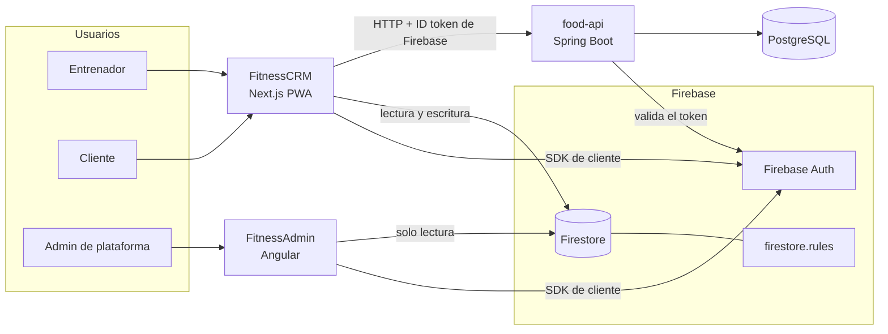

# FitnessCRM

**HECTOR** es una app de seguimiento para entrenadores personales y sus clientes: rutinas, macros y
menús, revisiones semanales de composición corporal y membresías. Esta organización reúne los tres
productos que la hacen funcionar.

| Repositorio | Qué es | Quién lo usa | Stack |
|---|---|---|---|
| [FitnessCRM](https://github.com/FitnessCRM/FitnessCRM) | La app HECTOR: panel del entrenador y área de cliente (PWA) | Entrenadores y clientes | Next.js 15 · React 19 · TypeScript · Firebase |
| [FitnessAdmin](https://github.com/FitnessCRM/FitnessAdmin) | Consola de la plataforma: todos los entrenadores y sus clientes | Administración de la plataforma | Angular 20 · TypeScript · Firebase |
| [food-api](https://github.com/FitnessCRM/food-api) | Catálogo común de alimentos con su composición por 100 g | La app, en nombre del entrenador | Java 21 · Spring Boot 4 · PostgreSQL |

---

## Para qué sirve

Un entrenador personal lleva a cada cliente con hojas de cálculo, mensajes y fotos sueltas. HECTOR
lo pone en un solo sitio:

- **El entrenador** da de alta clientes, mantiene su biblioteca de ejercicios y alimentos, asigna
  planes desde plantillas, revisa las revisiones semanales y envía feedback.
- **El cliente** consulta su rutina y su menú, registra su peso cuando quiere y envía su revisión
  semanal, también sin conexión.
- **La plataforma** ve el conjunto —cuántos entrenadores, cuántos clientes, en qué estado— sin
  entrar en la app de nadie.

La arquitectura es multi-tenant desde el primer día, aunque el lanzamiento sea con un solo
entrenador.

---

## Arquitectura

**Un solo proyecto de Firebase es la identidad común.** Los tres productos confían en los mismos
tokens de Firebase Auth, cada uno a su manera:

| Producto | Cómo se autentica | Qué puede hacer |
|---|---|---|
| FitnessCRM | Correo y contraseña; el rol sale de `users/{uid}.role` (`trainer` o `client`) | Cada entrenador lee y escribe su cartera; cada cliente, lo suyo. Lo imponen las reglas de Firestore |
| FitnessAdmin | Correo y contraseña con el *custom claim* `admin: true`, que se concede a mano con un script | Lee `trainers` y `clients` de todos los tenants. No escribe nada |
| food-api | No tiene usuarios propios: valida el ID token de Firebase como *resource server* JWT | El `sub` del token es el autor de un alimento; solo el autor lo edita o lo archiva |

### Dos formas de integrarse, a propósito

- **FitnessCRM y FitnessAdmin comparten Firestore.** No hay backend entre ellos: los dos usan el
  SDK de cliente y las reglas de seguridad son el contrato. El admin solo existe en las reglas como
  un permiso de lectura más.
- **food-api es un servicio independiente.** La app solo habla con él por HTTP y su contrato es
  `api/openapi.yaml`. Tiene su propia base de datos (PostgreSQL con búsqueda por trigramas) porque
  un catálogo común que se busca por texto no encaja en Firestore.

Los alimentos propios de cada entrenador viven en Firestore, dentro de su tenant; el catálogo común
viene de food-api, detrás de su propio puerto en la app.

### El mismo principio en los tres: el dominio no conoce la infraestructura

| Repositorio | Patrón | Dónde entra la infraestructura |
|---|---|---|
| FitnessCRM | Puertos y adaptadores. `lib/domain/` es TypeScript y zod puros | Solo `lib/data/adapters/firebase/` importa el SDK; la UI pasa por los hooks de `lib/data/hooks/`. Sin variable de entorno se monta un adaptador en memoria |
| FitnessAdmin | Puertos y adaptadores en `src/app/core/` | Solo `FirestoreAdminDataSource` y `FirebaseAuthPort` importan Firebase |
| food-api | Clean Architecture + CQRS en un módulo | `api` e `infrastructure` → `application` → `domain`. ArchUnit hace cumplir las capas |

Cambiar de backend en cualquiera de ellos es escribir un adaptador nuevo, no tocar el dominio ni
las pantallas.

---

## Cada repositorio

<strong>FitnessCRM</strong> — la app HECTOR

- **Stack:** Next.js 15 (App Router), React 19, TypeScript strict, Tailwind CSS v4, shadcn/ui,
  TanStack Query, react-hook-form + zod, Recharts, Serwist (PWA). pnpm y Node 22.
- **Datos:** Firestore y Auth desde el cliente, sin fetching en Server Components. El área de
  cliente funciona sin conexión y encola las escrituras de series y pesos.
- **Tests:** Vitest para el dominio y la lógica pura; el adaptador de Firebase y las reglas, contra
  los emuladores.
- **Empezar:** `pnpm install` · `pnpm dev` · `pnpm test`

<strong>FitnessAdmin</strong> — consola de la plataforma

- **Stack:** Angular 20 standalone con signals, `@angular/fire`, TypeScript. Karma + Jasmine.
  pnpm.
- **Pantallas:** login, panel con el resumen de todos los entrenadores y clientes, y el detalle de
  cada entrenador.
- **Acceso:** guard sobre el claim `admin: true`. Se concede con
  `pnpm set-admin-claim <email> <clave-de-servicio.json>`.
- **Despliegue:** Firebase Hosting.
- **Empezar:** `pnpm install` · `pnpm start` · `pnpm test`

<strong>food-api</strong> — catálogo común de alimentos

- **Stack:** Java 21, Spring Boot 4, Spring Security (OAuth2 resource server), JDBC, Flyway,
  PostgreSQL con `pg_trgm` y `unaccent`. Testcontainers y ArchUnit. Maven.
- **API:** `GET` y `POST /foods`, `GET`, `PUT` y `DELETE /foods/{id}` (borrar es archivar). Errores
  en formato RFC 9457. Swagger UI en `/swagger-ui.html`.
- **Datos de desarrollo:** Open Food Facts (ODbL).
- **Empezar:** `./mvnw verify` (necesita Docker para los tests).

---

## Cómo trabajamos

- **Una tarjeta, una rama, un PR.** Ramas desde `main`, *Squash and merge* en GitHub y nadie empuja
  a `main`.
- **Conventional Commits** en inglés: `feat(domain): add review completeness check`.
- **El código va en inglés y la interfaz en español**, con todos los textos visibles en un único
  archivo de i18n por app.
- **Lo compartido va primero y va solo:** un cambio de dominio, de puerto o de contrato entra en su
  propio PR antes que las pantallas que lo usan.
